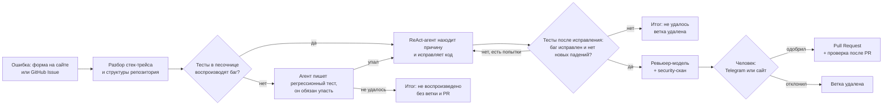

# AI Bug Investigator

Агент-помощник разработчика. Получает текст ошибки или стек-трейс и, в зависимости от режима, либо **находит и исправляет баг с проверкой тестами**, либо **объясняет, где ошибка и как её исправить**.

> Главный принцип — честность. Агент не выдаёт догадку за исправление: нет воспроизведения бага — нет исправления; исправление не подтверждено тестами — к человеку с ним не идут; диагноз без доступа к коду явно помечается как гипотеза.

**Стек:** Python 3.12 · FastAPI · LangGraph · Groq (бесплатные модели) · LangSmith · Docker · Telegram Bot API
**Языки исправляемых проектов:** Python (pytest) · JavaScript/TypeScript (Jest, Vitest, node --test) · Go (go test)

---

## Три режима работы

Режим выбирается по полю «Репозиторий» в форме (или полю `repo` в API).

| Режим | Что указать в поле «Репозиторий» | Что делает агент | Результат | Нужны ключи |
|---|---|---|---|---|
| **1. GitHub-репозиторий** | `owner/name` | Воспроизводит баг тестами в песочнице, находит причину, исправляет, проверяет тем же тестом, ждёт решения человека | Pull Request с описанием и регрессионным тестом, проверка после PR | Groq, GitHub |
| **2. Локальная папка** | `local:<папка>` | То же самое для git-проекта на компьютере, без GitHub | Ветка `ai-fix/...` в проекте; рабочие файлы и текущая ветка не меняются | Groq |
| **3. Только текст ошибки** | оставить пустым | Разбирает текст ошибки без доступа к коду | Диагноз: где ошибка, причина, шаги и пример исправления, уверенность | Groq |

### Режим 1 — GitHub-репозиторий



1. **Воспроизвести.** Тесты исходного кода запускаются в изолированной Docker-песочнице. Если существующие тесты баг не ловят, агент пишет регрессионный тест и требует, чтобы он падал на исходном коде (и не из-за ошибки в самом тесте).
2. **Найти причину.** ReAct-агент читает код и ищет по репозиторию, используя вывод упавших тестов как улику. Указывает место дефекта, а не строку, где всплыло исключение; может честно ответить «дефекта нет».
3. **Исправить и проверить** (Reflexion). Исправление засчитывается, только если баг-тесты теперь проходят и нет новых падений. Иначе модель получает лог и пробует снова — до 3 попыток.
4. **Human-in-the-Loop.** Граф LangGraph останавливается (`interrupt`) и ждёт решения: кнопки в Telegram, если указан `@username`, иначе на сайте.
5. **Pull Request** с описанием, регрессионным тестом и комментарием о проверке после PR. Мерж — только человеком.

Ошибки можно передавать и через GitHub Issues с меткой `bug`: сервис опрашивает репозитории из `WATCHED_REPOS` (публичный адрес не нужен) или принимает вебхук с проверкой подписи.

### Режим 2 — локальная папка

Положите git-проект в папку `local-projects/` (или укажите свою в `LOCAL_PROJECTS_DIR` в `.env`) и введите в форме `local:<имя папки>`. Папка подключается в контейнер сервиса; агент проходит тот же путь, что в режиме 1, но результат — ветка `ai-fix/...`, собранная низкоуровневыми командами git без изменения ваших файлов. В итоге будут команды, чтобы посмотреть и применить изменения:

```bash
git -C local-projects/my-app diff main..ai-fix/<id>
```

```bash
git -C local-projects/my-app merge ai-fix/<id>
```

### Режим 3 — только текст ошибки

Оставьте поле «Репозиторий» пустым и вставьте стек-трейс или описание ошибки. Примерно через 2 секунды агент покажет:

* **где ошибка** — место и цепочку вызовов из стек-трейса (это факт: извлекается без модели), тип и сообщение ошибки;
* **почему и как исправить** — причину, шаги, пример кода, уровень уверенности, как проверить и чего не хватает для точного ответа.

Это гипотеза, и она так помечена: код не читался, тесты не запускались. Для проверенного исправления используйте режим 1 или 2.

## Быстрый старт

Нужен Docker.

```bash
cp .env.example .env
```

Заполните в `.env` ключи — где их взять, описано в [docs/setup.md](docs/setup.md):

| Переменная | Нужна для | Обязательна |
|---|---|---|
| `GROQ_API_KEY` | Модели (все режимы) | да |
| `GITHUB_TOKEN` | Режим 1 (GitHub) | для режима 1 |
| `TELEGRAM_BOT_TOKEN` | Одобрение и итоги в Telegram | нет |
| `LANGSMITH_TRACING`, `LANGSMITH_API_KEY` | Трейсы в LangSmith | нет |
| `LOCAL_PROJECTS_DIR` | Папка с проектами для режима 2 | нет (по умолчанию `./local-projects`) |
| `WATCHED_REPOS` | Автоматический приём GitHub Issues | нет |

```bash
make up
```

Откройте http://localhost:8000. Документация API: http://localhost:8000/docs.

| Команда | Что делает |
|---|---|
| `make up` / `make down` | Запустить / остановить сервис |
| `make logs` | Логи сервиса |
| `make test` | 78 автотестов в контейнере Python 3.12 (без сети и ключей) |
| `make lint` | Ruff |

## Как проверить на тестовом проекте

Для проверки подготовлен отдельный репозиторий с известной ошибкой — [xxxhellperxxx-maker/test-project](https://github.com/xxxhellperxxx-maker/test-project): небольшой магазин на Python, где заказ с товаром без скидки падает с `KeyError: 'discount'` (на исходном коде падают 2 теста из 7).

1. Сделайте форк репозитория (агенту нужно право записи, чтобы создать ветку и PR) и укажите свой форк в поле «Репозиторий», например `ваш-логин/test-project`.
2. В поле ошибки вставьте стек-трейс из README тестового проекта — или просто опишите проблему: «если в заказе есть книга, расчёт суммы падает».
3. Ожидаемый результат: агент воспроизводит 2 падения, находит причину в `shop/pricing.py`, исправляет и подтверждает исправление (7 passed), после одобрения создаёт Pull Request.

Без GitHub то же самое можно проверить в режиме 2: склонируйте тестовый проект в `local-projects/test-project` и укажите `local:test-project`. Для режима 3 достаточно вставить стек-трейс с пустым полем «Репозиторий».

Ещё демо-проекты с багами лежат в [examples/](examples): Python, JavaScript и Go.

## Проверено вживую

Настоящие модели Groq, Docker-песочница, GitHub и Telegram:

| Сценарий | Результат |
|---|---|
| Режим 1: ошибка без стек-трейса, только текст жалобы | Песочница воспроизвела 2 падения, агент нашёл причину в `shop/pricing.py`, исправление подтверждено (7 passed), создан PR |
| Режим 1: полный цикл через Telegram | `/start` → бот сам узнал chat ID → запрос с diff и кнопками → «Одобрить» → PR → проверка после PR в песочнице |
| Баг, который тесты не ловят (цена 849 вместо 849.15) | Агент написал регрессионный тест, тест упал на исходном коде, после исправления прошёл |
| Баг в данных другого модуля (цена строкой в `catalog.py`, падает в `pricing.py`) | Исправлена причина в `catalog.py`, а не симптом; 2 регрессионных теста |
| JavaScript + Jest, Go с непокрытым тестами багом | Воспроизведено и исправлено; для Go агент сам написал тест в нужном пакете |
| Режим 2: Python, JS и Go-проекты в локальной папке | Исправление в ветке `ai-fix/...`, рабочие файлы и текущая ветка не изменены; при отказе ветка удаляется |
| Режим 3: трейсы Python, JS, Go и текст без трейса | ≈2 с на ответ; место ошибки взято из трейса, без трейса — честное «нет в тексте» |
| Ложная жалоба на правильный код | «Ошибку не удалось воспроизвести» — без ветки, PR и запроса одобрения |
| Prompt injection в тексте ошибки | Проигнорировано во всех режимах |
| Процесс убит посреди исправления | После рестарта запуск продолжился с чекпойнта и дошёл до PR |
| Лимит бесплатного Groq посреди работы | Автоматическое переключение на запасную модель |

Подробности и даты — в [docs/testing.md](docs/testing.md).

## Соответствие ТЗ

| Критерий | Базовый уровень | Реализовано |
|---|---|---|
| Входные данные | Ручной ввод | Форма на сайте; GitHub Issues (опрос, без публичного адреса); вебхук GitHub с проверкой подписи; локальные проекты; только текст ошибки. Sentry — не подключён |
| Поиск кода | По ключевым словам | Структура репозитория через GitHub API, сопоставление фреймов стек-трейса, инструменты `read_file`, `search_code`, `list_files` |
| Тестирование | Генерация кода | Docker-песочница без сети: тесты до и после исправления, регрессионные тесты, 3 языка |
| Инструменты | 1 инструмент | GitHub API, запуск кода в песочнице, проверка синтаксиса, security-скан, поиск, Telegram |
| Результат | Текст в чате | Pull Request с объяснением и тестом, комментарий о проверке после PR |
| Агентные паттерны | — | Plan-and-Execute (граф), ReAct (расследование), Reflexion (повтор с логом тестов) |
| Граф состояний | — | LangGraph + SQLite-чекпойнты (переживает перезапуск) |
| Обработка ошибок | — | Повторы GitHub API, запасная модель, ошибки инструментов возвращаются агенту для перепланирования |
| Human-in-the-Loop | — | `interrupt` перед созданием PR; Telegram-кнопки или сайт |
| UI | Streamlit / Chainlit / Custom | Свой веб-интерфейс на FastAPI: статус агента в реальном времени, карточки одобрения и диагноза |
| Observability | LangSmith | Трейсы каждого запуска, токены; лента событий в интерфейсе |
| Расширения | — | Security Audit (OWASP), одобрение в Telegram, кэш структуры репозитория |

## Безопасность

* Код чужого репозитория выполняется только в одноразовом контейнере: тесты без сети, read-only файловая система, без capabilities, лимиты памяти, CPU, процессов и времени, без секретов сервиса.
* Текст ошибки и issue — недоверенные данные: модели запрещено выполнять инструкции из них; пути от модели проверяются по дереву репозитория.
* Решение принимает только человек; повторное одобрение блокируется; агент никогда не мержит.
* Ключи — только в `.env` (не входит в репозиторий); токены не попадают в логи. Сервис слушает только `127.0.0.1`.

## Ограничения

* За один запуск исправляется один файл (плюс регрессионный тест).
* Песочница — Python, JS/TS, Go; для остальных языков в режиме 1 нужен GitHub Actions.
* Падающие тесты на исходном коде считаются воспроизведением жалобы. Если в `main` уже падают посторонние тесты, исправление засчитывается только при починке всех; если они ловят другой баг, человек увидит это в карточке одобрения.
* Доступ к сокету Docker равен правам администратора хоста, на сайте нет входа по паролю — сервис не предназначен для публикации в интернет в текущем виде.
* Бесплатный тариф Groq ограничивает число токенов в минуту; список моделей меняется (названия вынесены в `.env`).

## Документация

| Документ | Содержание |
|---|---|
| [docs/setup.md](docs/setup.md) | Ключи Groq, GitHub, Telegram, LangSmith; песочница; локальный режим; демо-проекты |
| [docs/architecture.md](docs/architecture.md) | Граф, узлы, ключевые решения, песочница, языки, режимы |
| [docs/api.md](docs/api.md) | REST API |
| [docs/testing.md](docs/testing.md) | Автотесты и живые сценарии |

## Структура

```text
app/
  agent/        граф LangGraph, промпты, инструменты агента, модели Groq
  api/          REST API, вебхук GitHub, страницы
  clients/      GitHub, локальные git-проекты, Telegram
  services/     разбор стек-трейса, диагноз по тексту, CI, разбор исправления и diff, security-скан
  watchers/     опрос GitHub Issues и Telegram (без публичного адреса)
  sandbox.py    Docker-песочница и честное сравнение «до/после»
  languages.py  профили языков: Python, JS/TS, Go
  web/          интерфейс
tests/          78 автотестов с двойниками GitHub, LLM, Telegram и песочницы
examples/       демо-проекты с багами: Python, JavaScript, Go
local-projects/ папка для режима 2 (содержимое не входит в репозиторий)
docs/           документация
```
